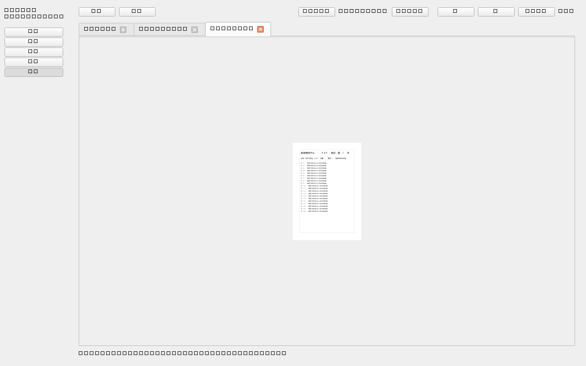

# MiniHub 极简媒体中心

一个干净的 Windows 桌面应用：视频、图片、文件、多标签文档，一个应用搞定。

**[⬇ 下载安装包（GitHub Releases）](https://github.com/pengbinbin1/mediaHub/releases/latest)**



## 功能特性

### 视频
- 播放 / 暂停 / 快进快退
- 进度条拖动定位

### 图片
- 上一张 / 下一张（自动扫描同目录图片）
- 旋转 / 缩放 / 适应窗口 / 1:1

### 文件浏览
- 全盘符树形浏览（此电脑视图）
- 全盘关键字实时搜索
- 右键操作：打开、在资源管理器中显示、复制、剪切、删除到回收站、重命名

### 多标签文档
- **多标签页**：可同时打开多个文档，每个文档独立一个页签
- **批量打开**：文件选择框支持一次多选，也可从资源管理器直接拖入多个文件
- TXT / Markdown / CSV / INI / LOG 等纯文本编辑
- Word (.docx) 富文本编辑（保留粗体 / 斜体 / 下划线 / 标题 / 列表等基础排版）
- PDF 查看：翻页、缩放、适应宽度、页码显示
- 未保存修改提示（页签标题带 ●，关闭时询问 保存 / 不保存 / 取消）
- 重复打开同一文件时自动切换到已有页签，不重复开

### 通用
- 拖放文件到窗口任意位置即可打开
- 自动识别文件类型并路由到对应页面（视频 / 图片 / 文档 / 其他类型调用系统默认程序）
- 最近打开记录（首页快速访问）
- 文件对话框记住上次使用的目录

## 环境要求

- Windows 10 / 11
- Python 3.12+（源码运行）

## 从源码运行

```bash
# 1. 创建虚拟环境
python -m venv .venv

# 2. 激活（PowerShell）
.venv\Scripts\Activate.ps1

# 3. 安装依赖
pip install -r requirements.txt

# 4. 运行
python run.py
```

## 构建安装包

```bash
# 构建主程序（dist\MiniHub\MiniHub.exe）
build_app.bat

# 构建单文件安装包（installer_build\MiniHub_Setup_1.0.0.exe）
python tools/build_installer.py
```

安装包支持标准的 Windows 安装与卸载流程。

## 项目结构

```text
app/
├── main.py             # 主窗口、侧边栏导航、文件路由
├── theme.py            # QSS 全局主题
├── dialogs.py          # 文件对话框（记住上次目录）
├── docx_io.py          # Word(.docx) 与富文本双向转换
└── pages/
    ├── home.py         # 首页：功能卡片 + 最近打开
    ├── video.py        # 视频播放页
    ├── image_viewer.py # 图片查看页
    ├── explorer.py     # 文件浏览页（全盘树 + 搜索）
    └── documents.py    # 多标签文档页（TXT/Word/PDF）
tools/                  # 构建与安装器脚本
samples/                # 示例媒体文件
test_multitab.py        # 多标签文档自动化测试（34 项）
run.py                  # 启动入口
requirements.txt        # 依赖清单
build_app.bat           # 一键构建脚本
```

## 自动化测试

```bash
.venv\Scripts\python.exe test_multitab.py
```

覆盖多标签文档的核心场景：多文件打开、未保存提示、关闭非当前页签时保存正确目标、拖放多文件、重复文件去重等。
